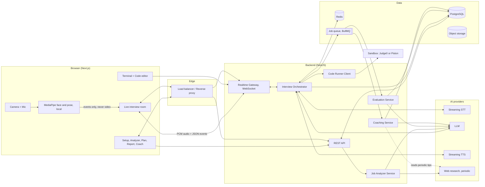
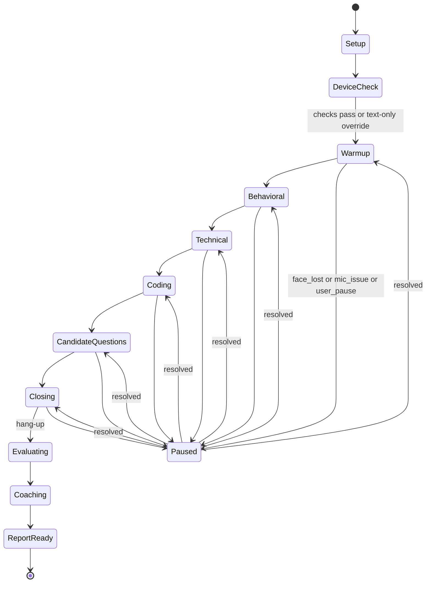

# MockRoom: System Architecture — Consolidated v2.1

**Project:** MockRoom, AI Mock Interview & Interview Coaching Platform
**Owner:** Abhishek
**Version:** 2.1 (28 Sep 2026) — aligns architecture with PRD v2 and TRD v2; designs the live room as a **real interview**, not a coaching chatbot

This document is the system design for the Product Requirements (PRD) and Technical Requirements (TRD). Coaching, Job Analyzer, scoring, and dashboards exist **around** the interview. They must not leak **into** the live call.

---

## 1. Design principle: two products, one loop

| Surface | What the candidate should feel | What the system may do |
|---|---|---|
| **Live interview** | A hiring interviewer on a video call: greeting, rounds, time pressure, follow-ups, coding, “do you have questions for me?”, close | Persona voice, STT/LLM/TTS, timers, face/mic **readiness** warnings, barge-in |
| **After hang-up** | A trainer: scores, rewrites, weak areas, retry queue | Evaluation job, Coaching job, Language Coach, Answer Library |

The loop from the PRD stays: interview → recording → evaluation → rewritten answers → practice → retry. The **live session is not the coach**. In Practice and Learning modes only, the interviewer may offer a brief hint **after** an answer. In Realistic, Pressure, Company Simulation, and Final Mock, there are no hints, no scores, and no “here is a better way to say that” until the report.

**Positioning (PRD):** MockRoom helps the candidate *become* able to do the interview themselves. It is not a live copilot.

---

## 2. High-level architecture



Stack matches the TRD: Next.js App Router + Zustand + native WebSocket + xterm.js + Monaco + MediaPipe WASM; NestJS modular monolith + `ws` gateway + PostgreSQL + Redis + BullMQ + S3-compatible storage; Deepgram (or Whisper MVP) / Claude (or swap) / ElevenLabs–Cartesia–OpenAI TTS; Judge0 or Piston sandbox.

---

## 3. End-to-end journey (PRD §6 mapped to systems)

1. **Auth** — `auth` module; JWT + refresh (or NextAuth); email + Google.
2. **My Target Role** — `jobs` + `storage`; paste or upload JD/resume (PDF/DOCX).
3. **Job Analyzer** — `parser` + `analyzer`; skill/confidence profile; every fact tagged `verified` | `reported` | `inferred`.
4. **Interview Plan** — `plans`; rounds, topics, counts, duration; user edits; picks **mode** and **persona**.
5. **Device check** — browser only for camera/mic/face; speaker playback confirmation; block start until pass, or **text-only override**.
6. **Live interview** — immersive room (no dashboard chrome); warm-up → behavioral → technical → coding → candidate questions → closing.
7. **Hang-up** — orchestrator enqueues Evaluation; client leaves the room.
8. **Evaluation** — multi-dimensional scores, per-question review, hire-readiness verdict, timeline.
9. **Communication Coach** — post-session rewrites; practice/re-record; Language Coach fillers/hedges.
10. **Recordings / Weak Areas / Retry / Answer Library** — `analytics` + `coaching` + search.

---

## 4. Component responsibilities

| Component | Responsibility |
|---|---|
| **App UI (Next.js)** | Setup wizard, Job Analyzer, plan editor, report, Communication Coach, recordings, performance, Weak Areas, Retry Mistakes, Answer Library |
| **Live interview room** | Full-screen video-call layout: interviewer stage, candidate PIP, captions, round timer, voice/code/terminal. No coaching cards, no score, no product sidebar |
| **Device check** | Live camera preview, one-face detection, mic RMS + test sentence STT, speaker test, consent copy, text-only override |
| **MediaPipe (browser)** | Face count, landmarks, head pose; emits `client.face` / `client.gaze` only. Video never uploaded unless the user opts in (PRD NFR Privacy) |
| **Realtime Gateway** | `wss://host/realtime?token=&sessionId=`; binary PCM 16 kHz mono in; TTS audio out; JSON events both ways (TRD §4) |
| **Interview Orchestrator** | Round/time/question **budgets**; follow-up vs next-question vs next-round; mode config; persona injection; spoken warnings; barge-in cancel |
| **Job Analyzer Service** | JD/resume → skills + confidence; source tags; cached company research only for Company Simulation |
| **STT / LLM / TTS** | Provider interfaces (`SttProvider`, `LlmProvider`, `TtsProvider`); swappable without touching the orchestrator |
| **Code Runner** | Isolated sandbox: 5 s CPU, 256 MB, no network; JS/Python/Java/C++ in v1 |
| **Evaluation Service** | Async post-session: category + per-question dimensions, metrics, timeline, verdict |
| **Coaching Service** | After evaluation: weakest sections rewritten without invented facts; Language Coach from metrics; practice scoring |
| **PostgreSQL / Redis / S3 / BullMQ** | Persistence; live session state + pub/sub + rate limits; files; Evaluation, Coaching, tip-refresh jobs |

---

## 5. Real interview session (what “realistic” means)

### 5.1 Room UX

The live route is an **immersive meeting**, not a dashboard page.

- Hide app sidebar and coaching navigation for `/device-check/*` and `/interview/*`.
- Layout: large interviewer stage (avatar + speaking ring + persona name/title as a meeting tile), **self-view PIP** with live camera (mirrored), captions as a strip on the stage, meeting-style controls (mute, pause, leave).
- Coding round: Monaco + run results replace the answer box; interviewer stays visible.
- Terminal is for typed answers when voice is hard (accents, accessibility), not the visual center of a “terminal product.”
- Captions optional (PRD accessibility); default on for MVP, toggleable.
- Do not show scores, rubrics, “what was missing,” or coaching rewrites in the room.
- Do not use product language in-character (“Welcome to MockRoom”, “generating your report”). The interviewer is a hiring manager/engineer at the target company style.

### 5.2 Opening and closing rituals

**Open (warm-up):** interviewer states their name and role, names the job, sketches the agenda (background, technical, coding, your questions), then asks for a self-introduction. One question at a time.

**Close:** after candidate questions, a short in-character close (“Thanks for your time, we’ll be in touch”). **Then** the client leaves and the backend starts Evaluation. “Your report is ready” is a **post-room** UI, not spoken as the last interview line in Realistic/Final Mock.

### 5.3 Round model (PRD FR-8, FR-14, FR-15, FR-17)

Live speaking rounds, in order:

| Round | Goal | Typical budget |
|---|---|---|
| `warmup` | Rapport + self-intro | 1 question, ~5 min |
| `behavioral` | STAR, collaboration, incident stories | plan-driven |
| `technical` | JD skills; probe unverified claims | plan-driven |
| `coding` | One problem; wait for submit; complexity/tradeoffs | plan-driven |
| `candidate_questions` | **Candidate interviews the interviewer** | ~5 min; interviewer answers, does not pile new assessment questions |
| `closing` | Thanks and in-universe next steps | 1 beat |

Setup, device check, evaluating, and coaching are **session lifecycle** states, not spoken rounds.

Each live round holds: `questionsAsked`, `followUpsAsked`, `timeRemaining`, `currentQuestionId`, plus **mode config** and **persona**. The orchestrator does **not** advance the round on every candidate utterance. It chooses:

1. **Follow-up** — vague, missing metric, unverified skill, or mode intensity still has budget.
2. **Next question** — same round, question budget remaining, time remaining.
3. **Next round** — question or time budget exhausted; interviewer transitions in spoken language (“I’d like to shift to a technical question”).
4. **Complete** — after closing.

Paused (face lost / mic issue / user pause) can apply from any live round; resume returns to the **same** round.

### 5.4 Mode config (PRD FR-17) — same state machine, different pressure

| Mode | Hints | Interruptions | Follow-ups | Think time |
|---|---|---|---|---|
| Practice | After the answer, optional | never | gentle | generous |
| Learning | After the answer, brief structure cue | low | moderate | generous |
| Realistic | none | low | moderate | standard |
| Pressure | none | medium–high | rigorous | tight |
| Company Simulation | none | medium | rigorous | standard |
| Final Mock | none | high | relentless | tight |

Think-time is a **soft clock the interviewer respects** (does not talk over the candidate immediately), not a visible quiz countdown unless Pressure/Final Mock.

### 5.5 Spoken conduct (interviewer LLM)

From TRD §6, plus real-call constraints:

- 1–3 short spoken sentences; no lists, markdown, or scores.
- One question per turn; acknowledge naturally (“Got it”, “That helps”) then probe.
- Vague answers get a STAR or specificity follow-up.
- Probe skills tagged `reported`/`inferred` or resume claims not yet evidenced.
- Never reveal scoring, remaining question count as a quiz, or coaching rewrites mid-call (except Practice/Learning hint rule).
- Manage time aloud like a human (“We have a few minutes for your questions”).
- Barge-in: stop TTS and cancel the LLM stream when candidate speech is detected during interviewer audio.

### 5.6 Instant acknowledgments (latency)

While the LLM thinks, play a short persona-safe filler (“Mm-hm”, “Okay”) so the gap to first TTS stays under the p50 1.5 s budget (PRD NFR, TRD §12).

---

## 6. Real-time voice pipeline

Two options; build **A** first, keep **B** as an upgrade (PRD risk: latency).

**Option A — Chained pipeline**
```
Mic -> VAD -> Streaming STT -> Orchestrator -> LLM (stream) -> sentence splitter -> Streaming TTS -> Speaker
```

**Option B — Speech-to-speech API**
```
Mic -> Realtime speech API -> Speaker
```
Orchestrator still injects persona/mode and stores transcripts for scoring.

**Latency budget (p50)**

| Step | Budget |
|---|---|
| End-of-speech detection (VAD) | 300 ms |
| Final STT transcript | 200 ms |
| LLM first tokens | 500 ms |
| First sentence to TTS audio | 300 ms |
| Network | 150 ms |
| **Total** | **~1.45 s** (target p50 1.5 s, p95 2.5 s) |

**Human feel:** sentence-level TTS; barge-in; 0.3–0.8 s pauses between thoughts; persona voice_id from TTS.

---

## 7. Session lifecycle state machine



`Evaluating` and `Coaching` are sequential **queued jobs** (TRD workers). The report can render scores before coaching cards finish. Face-lost warning target: under 5 s from loss to spoken/visual warning (TRD §12).

---

## 8. Live warning logic (readiness only)

| Condition | Detection | Action |
|---|---|---|
| Face not visible | No face in MediaPipe for **4 s** (FR-9) | Pause timer; interviewer **says** they cannot see the candidate; red/amber banner; resume when face returns |
| Multiple faces | More than one face for 3 s | Warn once; log `client_events` |
| Mic silent | RMS below threshold for **6 s** in an answer window (FR-10) | Spoken prompt to check the mic |
| Poor network | WebSocket RTT high | Indicator; lower audio bitrate |
| Long silence | No speech for 10 s | Gentle nudge; in Learning/Practice may offer to rephrase |

**Trust (PRD non-goals + FR-9 + NFR Trust):** face/pose are **device and presence checks**. They must **not** feed personality, attractiveness, or the hire-readiness verdict. Body-language *analysis* (eye contact, posture) is **P2**; if shipped later, it is a separate presence metric with explicit disclosure — never appearance scoring. Default hireability uses spoken content, structure, coding, and speech metrics, not the camera.

---

## 9. Device check pipeline (FR-5–FR-7)

1. Consent: camera, mic, and data use (TRD §10).
2. Live preview; detect **exactly one** face.
3. Mic meter; candidate reads a test sentence; show transcription.
4. Speaker test: play a short phrase; candidate confirms they heard it.
5. Block **Start interview** until camera, mic, and speaker pass.
6. **Text-only override** for accessibility: skip camera/speaker, captions + typed answers.
7. On pass, create/join session and enter the immersive room; interviewer opening turn starts after audio unlock (browser autoplay).

---

## 10. Job Analyzer pipeline

1. User submits JD (and optionally resume).
2. Parser LLM → `{ role, seniority, skills[{name, importance, sourceType}], responsibilities, topics }`.
3. Tags: `verified` (in JD/resume text), `reported` (public interview anecdotes, **Company Simulation only**), `inferred` (likely focus — never “this is what they will ask”).
4. Company Simulation: cached public careers/engineering research; not fetched every session.
5. Output: skill-confidence bars + plan generator input.

---

## 11. Evaluation pipeline (post-session)

1. Hang-up → Evaluation job.
2. Load transcript, timestamps, submissions, code results, `client_events`.
3. **Rule-based metrics:** WPM, fillers/hedges, pauses, face-visible %, tests passed. Eye-contact % only if P2 pose is enabled.
4. **LLM rubric** (temperature 0–0.2), Zod-validated JSON (TRD §7): overall 0–100, verdict `Not ready | Almost there | Ready | Strong`, categories, per-question dimensions (relevance, technicalAccuracy, structure, specificity, confidence), strengths / improvements / suggestedStructure / evidence / idealAnswer, timeline, topRecommendations.
5. Combine with default weights (PRD §9; configurable per role). **Do not** put face detection into the hireability verdict.
6. Enqueue Coaching job. Report generation target: under 60 s (TRD §12).

---

## 12. Coaching pipeline (post-session only)

1. Weakest sections first (self-intro if present).
2. Tips from `coaching_tips` (periodic worker, not live research).
3. Rewrite: original, issues, rewritten “say it like this”, reasoning — **no invented facts** (FR-21).
4. Language Coach: filler/hedge flags from Evaluation metrics (no extra LLM).
5. Write `coaching_sections`; badge on sidebar (dashboard, not live room).
6. Practice attempts scored vs original → `coaching_practice_attempts`. Coaching generation target: under 90 s after report.

---

## 13. WebSocket protocol (TRD §4)

**Client → server:** `audio.chunk` (PCM 16 kHz mono); `client.face` `{ state: lost|found, at }`; `client.gaze` `{ offCamera, at }`; `client.terminal.submit` `{ questionId, text, kind: text|code, language? }`; `client.control` `{ action: pause|resume|end }`; `client.interrupt` `{ at }`.

**Server → client:** `server.transcript.interim|final`; `server.audio.chunk`; `server.interviewer.text` `{ text, turnId }`; `server.state` `{ round, timeRemaining, questionIndex, total, mode, persona }`; `server.warning` `{ type: face|mic|network, message }`; `server.code.result`; `server.session.ended` `{ reportPending: true }`.

---

## 14. Data flow for one interview turn

1. Candidate speaks; browser streams PCM over WebSocket.
2. Gateway → STT; interim captions optional.
3. VAD end-of-speech → final transcript → orchestrator.
4. Orchestrator loads Redis session (mode, persona, round budgets, last N turns, JD summary, unverified skills).
5. Decide follow-up vs next question vs round change vs close.
6. LLM streams; sentence splitter → TTS; audio to browser. Filler ack may play first.
7. Persist `turns` (and `questions` when a new question is opened) asynchronously.
8. On `client.interrupt`, cancel TTS + LLM; enter listening.

---

## 15. REST surface (TRD §3, abbreviated)

Auth (`/auth/*`, `/me`); resumes; jobs + `/jobs/:id/analysis`; plans generate/edit (mode, persona); sessions create/get/end/report/delete; coaching sections + practice + trends; analytics progress / weak-areas / retry-queue; `/answers/search`.

---

## 16. Security, privacy, trust

- Argon2/bcrypt passwords; short-lived JWT; session-scoped WS tokens; rate limits; upload type/size checks; sandbox isolated.
- Video stays in the browser unless opt-in recording; recordings encrypted; signed expiring URLs.
- Transcripts, resumes, coaching scoped to the user; deletion removes DB + files.
- Analyzer copy never presents inferred guidance as guaranteed real questions.

---

## 17. Scalability and deployment

- Stateless NestJS behind LB with sticky WebSockets; Redis pub/sub across instances.
- Separate workers: Evaluation, Coaching, JD parse, tip-refresh.
- Docker; GitHub Actions; VPS then Kubernetes; sandbox on isolated network.
- Observability: structured logs, per-pipeline-step latency, error tracking.
- Targets: 500 concurrent sessions v1; dashboard LCP under 2.5 s; 99.5% availability MVP.

---

## 18. What this version fixes vs v2.0 architecture

- Live room specified as a **video interview**, not a coached quiz with product chrome.
- **`candidate_questions` is a first-class round**; rounds do not advance on every utterance — follow-ups stay in-round.
- Mode/persona change pressure, not the machine.
- Face/mic warnings are spoken readiness checks; **face does not drive hireability**.
- Coaching and scores happen **after hang-up**.
- Device check, WS protocol, REST, and evaluation/coaching schemas from the TRD are part of this design, not a separate document-only list.
